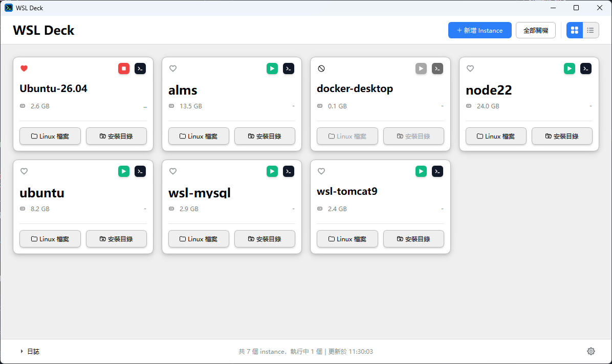
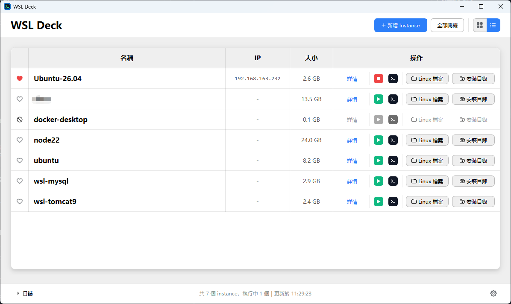
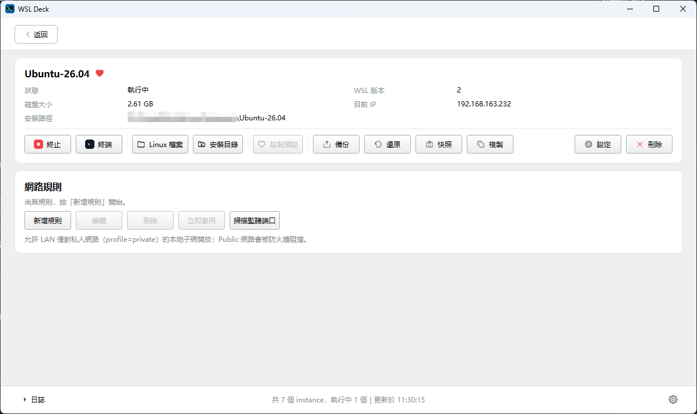

# WSL Deck

管理 WSL2 實例的 Windows 桌面程式。

[](./LICENSE)
[](https://www.microsoft.com/windows)

WSL 實例裝多了之後，哪台是幹嘛的、IP 多少、磁碟吃了多少，全得開 PowerShell 敲指令查。受夠了，所以寫了這個：打開就是一頁卡片（或表格），每台實例的狀態、IP、容量都在上面，啟停、開終端、備份、做快照都是按一下的事。

底層就是 `wsl.exe`、`netsh` 和 restic，沒有魔法。這些指令本來就能自己敲，這裡只是把它們排在同一個視窗裡。快照是官方沒有的功能，用 restic 做增量備份，第一次用快照功能時程式會自己從 restic 官方 releases 抓一支 Linux 靜態二進位下來，之後就不會再抓了。

## 畫面

首頁兩種檢視，右上角切換；點卡片或「詳情」進到單台實例的詳情頁。

| 卡片牆 | 列表 | 詳情頁 |
|:---:|:---:|:---:|
|  |  |  |

## 功能

| 功能 | 底層 |
|------|------|
| 實例列表（卡片／表格兩種檢視） | `wsl --list --verbose` ＋註冊表 |
| 狀態、IP、磁碟大小、預設標記 | `wsl -d <name> -- hostname -I`（背景查，不卡 UI） |
| 新增實例三步精靈 | `wsl --install`／`wsl --import`（tar、VHDX 都行） |
| 啟停、開終端、開檔案位置 | `wt.exe`、`explorer.exe` |
| 備份／還原／複製／刪除 | `wsl --export`／`--import`／`--unregister` |
| 增量快照（每日／每週／每月保留） | restic |
| 改 `/etc/wsl.conf`、預設使用者、systemd | `wsl -u root -- sh -c` |
| Windows 端口轉發＋防火牆 | `netsh portproxy`、`netsh advfirewall`（批次提權） |
| 托盤、開機自啟、深淺主題 | Qt |
| 全域代理 | 環境變數注入子行程 |

有幾件事刻意不做：Docker Desktop 那兩個系統實例只看不碰（弄壞了 Docker 自己負責）；還原是「先備份再整台蓋掉」，不做 diff；SSH 和檔案傳輸不內建，反正終端機和檔案總管都開得到。還有，只支援 Windows——程式裡全是 `netsh` 和註冊表，搬到別的平台沒意義。

## 系統需求

| 項目 | 需求 |
|------|------|
| 作業系統 | Windows 10/11（64 位元） |
| WSL | WSL2 已啟用，至少裝了一個發行版 |
| Python（從原始碼跑才需要） | 3.14+（開發時用的是 3.14.2） |

## 跑起來

```powershell
git clone https://github.com/aqianglee/wsl.git
cd wsl-deck\wsl-deck
py -3.14 -m venv .venv
.\.venv\Scripts\python.exe -m pip install -r requirements.txt
.\.venv\Scripts\pythonw.exe main.py
```

最後一行用 `pythonw` 不是筆誤——這樣才不會多跳一個黑色主控台出來。執行時依賴只有一個 PySide6-Essentials 6.12。第一次啟動記得進「設定」把工作目錄改成你自己的路徑，預設值是我機器上的。

不想裝 Python 的話，Releases 會放編譯好的安裝包和免安裝 zip。

## 自己編譯

```powershell
.\build.ps1             # PyInstaller → dist\WSL Deck\WSL Deck.exe
.\build-installer.ps1   # 再打 Inno Setup 安裝包（要先裝 Inno Setup 6）
.\build-zip.ps1         # 或免安裝 zip
```

版本號只改一個地方：`installer\WSL Deck.iss` 裡的 `#define MyAppVersion`。

## 測試

```powershell
.\.venv\Scripts\python.exe -m unittest discover -s tests -q
```

135 項，全是 mock，不會真的去碰 `wsl.exe`、註冊表或 UAC，一秒左右跑完。

## 目錄長這樣

```
倉庫根
├── plans\              ← 開發過程的需求與里程碑紀錄
├── docs\handover\      ← 架構、建置、排障文件
└── wsl-deck\           ← 應用本體，指令都在這層跑
    ├── main.py
    ├── app\            ← 業務邏輯
    │   └── ui\         ← Qt 介面
    ├── tests\
    ├── assets\         ← 圖示
    └── installer\      ← Inno Setup 腳本
```

## 設定檔

`config.json` 是本機狀態，git 不追蹤，第一次啟動會用預設值生出來。比較重要的 key 是 `workspace_root`（實例、備份、快照都放這下面）、`theme`、`proxy`、`close_to_tray`，完整的欄位說明直接看 [app/config.py](./wsl-deck/app/config.py) 比較快。

順帶提醒：快照的密碼檔在 `snapshots\<名字>\repo.pass`，明文。`.gitignore` 已經把整個 `snapshots\` 擋掉了，但自己搬備份的時候也別把它順手上傳。

## 幾個常見問題

**視窗沒出現？** 如果是從 AI 工具或 CI 啟動的，GUI 子行程會在命令結束時被回收，看起來像沒跑。雙擊 exe 或用 `pythonw` 啟動就好。

**docker-desktop 為什麼不能動？** 那是 Docker Desktop 自己管的實例，弄壞了重灌 Docker 的是你，所以鎖起來只看不碰。

**改網路規則為什麼跳 UAC？** `netsh` 要管理員。程式會把這次要改的規則湊成一批，開一個提權行程一次跑完，不用每條按一次。

## 授權

[MIT](./LICENSE)。用了 PySide6（LGPLv3，動態連結）和 restic（BSD 2-Clause），安裝包用 Inno Setup 做的，感謝這些專案。

## English

WSL Deck is a Windows desktop app for managing WSL2 distributions — see all instances with their status, IP and disk usage at a glance, start/stop them, open terminals, backup/restore/clone, and take incremental snapshots (restic-based, with daily/weekly/monthly retention). It also edits `/etc/wsl.conf` and manages Windows port forwarding rules with a single batched UAC prompt. Built with Python 3.14 and PySide6, Windows only, MIT licensed. Issues and PRs in English are welcome.
