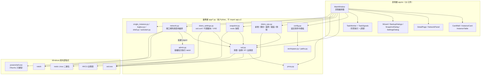
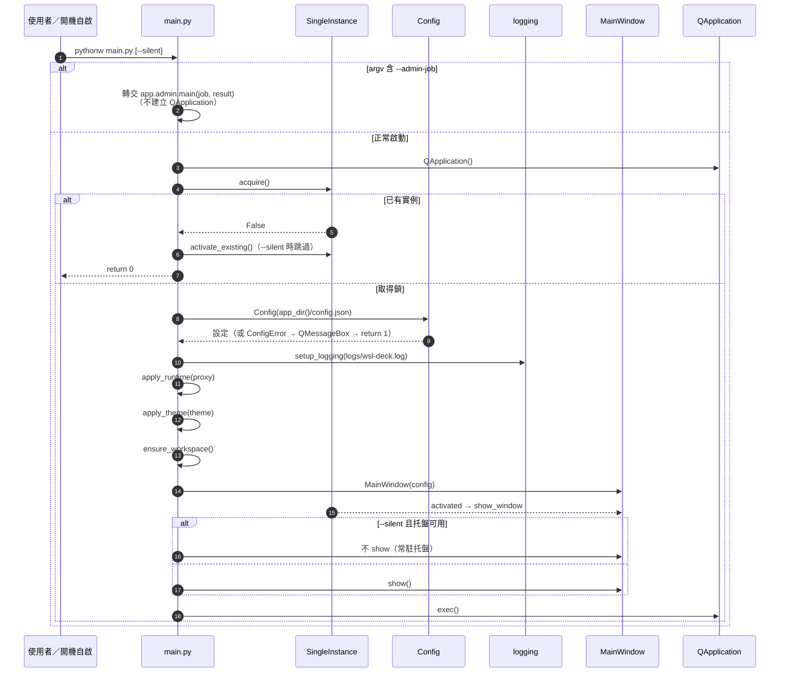
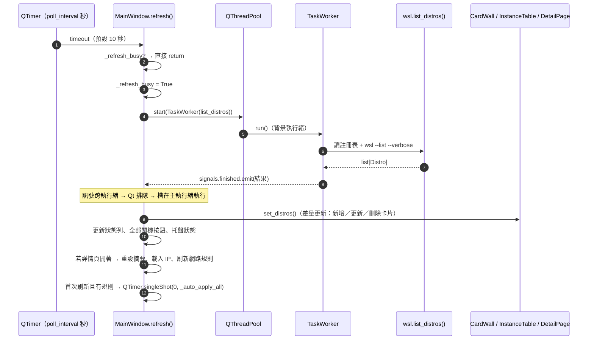
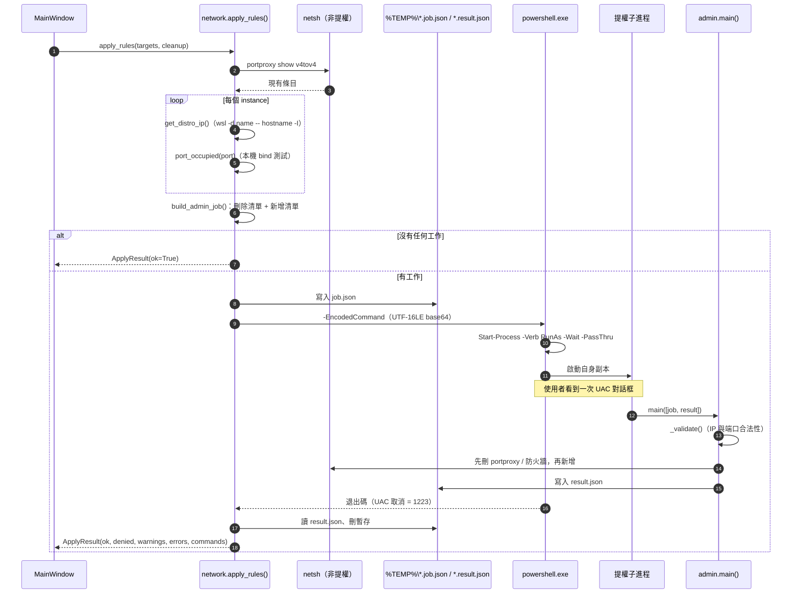
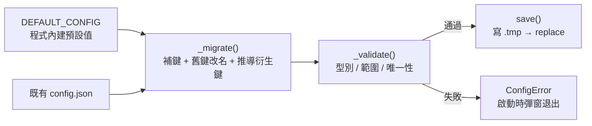
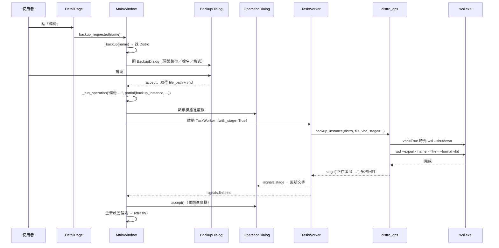

# WSL Deck 架構

> 讀法：先看第 1 節的分層圖，再看第 3 節的模組職責表按圖索驥，最後看第 4–6 節三條主鏈的時序圖。
> 本文只講「程式怎麼組織、資料怎麼流動」，語言層細節見 [01-python-primer.md](./01-python-primer.md)。

---

## 1. 分層總覽



### 依賴方向規則

| 規則 | 現狀 | 說明 |
|------|------|------|
| `app/ui` 可 import `app/*` | 成立 | 表現層呼叫業務層 |
| `app/*` 禁止 import `app/ui` | **成立**（本次已用 grep 全量確認） | 業務層不知道 UI 存在，可獨立測試 |
| `app/ui` 內部互相 import | 成立 | `dialog_base`、`cursors`、`icons` 是被共用的底層元件 |
| 業務層之間單向依賴 | 大致成立 | 以 `wsl.py` 為中心；`network.py` 例外地**在函式內**延遲 import `admin`（[network.py:199](../../wsl-deck/app/network.py#L199)），避免模組載入期就牽進提權邏輯 |

### 兩個現實例外（讀程式時不要被絆住）

1. **MainWindow 是「編排器 + 半個業務層」**。它不只畫畫面，還直接決定流程順序（先終止再備份、套用前先取 IP、失敗後回滾），並直接呼叫 `distro_ops`／`snapshot`／`network`。這是本專案最明顯的架構債，見 [05-risks-conventions.md](./05-risks-conventions.md#4-技術債分級)。
2. **`app/logbus.py` 是業務層目錄下唯一依賴 Qt 的檔案**（[logbus.py:8](../../wsl-deck/app/logbus.py#L8)）。它用 `QObject` 的訊號把 logging 轉送給 UI；沒有它，UI 就收不到日誌。

---

## 2. 資料從哪裡來

| 資料 | 來源 | 程式 |
|------|------|------|
| 實例清單 | 註冊表 `HKCU\Software\Microsoft\Windows\CurrentVersion\Lxss` **為主**，`wsl --list --verbose` **為輔** | [wsl.py:192](../../wsl-deck/app/wsl.py#L192) |
| 執行狀態、IP | `wsl.exe` CLI | [wsl.py:106](../../wsl-deck/app/wsl.py#L106)、[wsl.py:274](../../wsl-deck/app/wsl.py#L274) |
| 磁碟大小 | `BasePath` 目錄下 `*.vhdx` 的 `stat().st_size` | [wsl.py:176](../../wsl-deck/app/wsl.py#L176) |
| 端口規則 | `config.json` 的 `port_forwards` 陣列 | [config.py:227](../../wsl-deck/app/config.py#L227) |
| 端口是否已生效 | `netsh interface portproxy show v4tov4` 的輸出 | [network.py:47](../../wsl-deck/app/network.py#L47) |
| 快照 | restic `snapshots --json`／`stats --json` | [snapshot.py:489](../../wsl-deck/app/snapshot.py#L489) |
| 實例內設定 | `/etc/wsl.conf` 與 `/etc/profile.d/99-wsl-deck-proxy.sh` | [distro_settings.py:218](../../wsl-deck/app/distro_settings.py#L218) |

**為什麼要「註冊表為主」**：`wsl.exe --list --verbose` 的輸出會被系統語言本地化（英文 `Running`／中文 `运行中`），且含 `\x00` 空字元。註冊表給的是穩定的 `DistributionName`、`BasePath`、`Version`、GUID；CLI 只用來補「現在是否在跑」。兩者合併邏輯在 [wsl.py:192-238](../../wsl-deck/app/wsl.py#L192-L238)，只存在註冊表、CLI 沒列的實例會被標成 `state="Unknown"`。

---

## 3. 模組職責表

### 3.1 業務層 app

| 檔案 | 職責 | 主要對外介面 |
|------|------|------------|
| [paths.py](../../wsl-deck/app/paths.py) | 可寫路徑：開發期＝應用根目錄，凍結後＝exe 同層 | `app_dir()`、`is_frozen()` |
| [workspace.py](../../wsl-deck/app/workspace.py) | 工作目錄骨架 `instances/backups/snapshots/_tools` | `WorkspacePaths`、`ensure_workspace()` |
| [config.py](../../wsl-deck/app/config.py) | `config.json` 載入／遷移／校驗／原子寫入；命令模板 | `Config`、`ConfigError`、`DEFAULT_CONFIG` |
| [proxy.py](../../wsl-deck/app/proxy.py) | SOCKS5 代理寫入進程環境、偵測 WSL 主機 IP、連線測試 | `ProxyConfig`、`apply_runtime()`、`current_proxy()` |
| [wsl.py](../../wsl-deck/app/wsl.py) | 實例清單、啟停、關機、預設、IP；註冊表讀取；`wsl.exe` 封裝 | `Distro`、`list_distros()`、`run_wsl()`、`is_system_distro()` |
| [distro_ops.py](../../wsl-deck/app/distro_ops.py) | 新增／備份／還原／複製／刪除；名稱與路徑校驗、磁盤空間檢查 | `NewInstancePlan`、`create_instance()`、`restore_instance()` |
| [distro_settings.py](../../wsl-deck/app/distro_settings.py) | `/etc/wsl.conf` 解析與保註解改寫、代理腳本、`fsutil` 稀疏檔、`--compact`、`--set-version` | `InstanceSettings`、`read_settings()`、`apply_settings()` |
| [snapshot.py](../../wsl-deck/app/snapshot.py) | restic 下載與呼叫、快照建立／列表／清理／校驗／單路徑還原 | `create_snapshot()`、`load_state()`、`restore_path()` |
| [network.py](../../wsl-deck/app/network.py) | 規則校驗、狀態判定、端口掃描、portproxy 查詢、套用編排 | `validate_rule()`、`rule_status()`、`apply_rules()` |
| [admin.py](../../wsl-deck/app/admin.py) | 提權批次：讀 job JSON → 執行 netsh → 寫 result JSON | `run_admin_job()`、`main()` |
| [single_instance.py](../../wsl-deck/app/single_instance.py) | 單實例：`QLockFile` 搶鎖 + `QLocalServer` 喚醒 | `SingleInstance` |
| [logbus.py](../../wsl-deck/app/logbus.py) | `logging` → Qt 訊號 → UI 日誌抽屜 | `setup_logging()`、`log_bus` |
| [shell.py](../../wsl-deck/app/shell.py) | 開 Windows Terminal／資源管理器 | `open_terminal()`、`open_path()` |
| [autostart.py](../../wsl-deck/app/autostart.py) | `HKCU\...\Run` 開機自啟（只支援凍結後的 exe） | `is_supported()`、`set_enabled()` |

### 3.2 表現層 app/ui

| 檔案 | 職責 |
|------|------|
| [main_window.py](../../wsl-deck/app/ui/main_window.py) | 主視窗：頁面堆疊（主頁／詳情頁）、全域動作、輪詢、托盤、日誌抽屜、所有流程編排 |
| [card_wall.py](../../wsl-deck/app/ui/card_wall.py) | 卡片網格，按 viewport 寬度自動換行（`280px` 一列） |
| [instance_card.py](../../wsl-deck/app/ui/instance_card.py) | 單張卡片：圖標列、名稱、兩顆底部按鈕 |
| [instance_table.py](../../wsl-deck/app/ui/instance_table.py) | 表格視圖：`InstanceRow` + `InstanceTable`（列高 48px） |
| [detail_page.py](../../wsl-deck/app/ui/detail_page.py) | 詳情頁：摘要格、10 顆動作按鈕、內嵌 `NetworkPanel` |
| [network_panel.py](../../wsl-deck/app/ui/network_panel.py) | 網路規則表與 5 顆操作按鈕 |
| [rule_dialog.py](../../wsl-deck/app/ui/rule_dialog.py) | 新增／編輯端口規則 |
| [scan_dialog.py](../../wsl-deck/app/ui/scan_dialog.py) | 掃描監聽端口後的勾選框 |
| [wizard.py](../../wsl-deck/app/ui/wizard.py) | 新增 Instance 三步精靈（`QWizard`） |
| [backup_dialogs.py](../../wsl-deck/app/ui/backup_dialogs.py) | `BackupDialog`／`RestoreDialog`／`CloneDialog`／`DeleteDialog` |
| [snapshot_dialog.py](../../wsl-deck/app/ui/snapshot_dialog.py) | 快照管理主窗 + `SnapshotCreateDialog` + `RestorePathDialog` |
| [instance_settings_dialog.py](../../wsl-deck/app/ui/instance_settings_dialog.py) | 常用設定（唯讀／可寫）＋維護操作（稀疏、壓縮、版本） |
| [settings_dialog.py](../../wsl-deck/app/ui/settings_dialog.py) | 全域設定：目錄、保留策略、代理、主題、自啟、輪詢 |
| [progress.py](../../wsl-deck/app/ui/progress.py) | 不可取消的模態進度框（Esc／關閉都被忽略） |
| [dialog_base.py](../../wsl-deck/app/ui/dialog_base.py) | 對話框基底：表單、錯誤列、取消／確定 |
| [workers.py](../../wsl-deck/app/ui/workers.py) | `TaskWorker(QRunnable)` + `TaskSignals`；`stage` 訊息注入 |
| [theme.py](../../wsl-deck/app/ui/theme.py) | Fusion 樣式 + 深色 palette；`system` 跟隨系統 |
| [tray.py](../../wsl-deck/app/ui/tray.py) | 托盤圖標與右鍵選單（顯示／啟動預設／全部關機／重套／結束） |
| [view_toggle.py](../../wsl-deck/app/ui/view_toggle.py) | 卡片／列表切換（兩顆互斥圖標按鈕） |
| [icons.py](../../wsl-deck/app/ui/icons.py) | 全部圖標用 `QPainter` 現畫（播放、停止、愛心、禁止、齒輪、格線、清單） |
| [app_icon.py](../../wsl-deck/app/ui/app_icon.py) | App 圖標：優先用 `assets/*.ico`，缺失時現畫 |
| [cursors.py](../../wsl-deck/app/ui/cursors.py) | 可用＝手型、禁用＝禁止游標 |

> 圖標為什麼要現畫？`icons.py` 的存在是為了少帶資源檔、且能依深淺主題換色；`assets/` 裡只有 App 的 `.ico`。

---

## 4. 主鏈一：啟動



對應程式碼：[main.py:11-64](../../wsl-deck/main.py#L11-L64)、[single_instance.py:32](../../wsl-deck/app/single_instance.py#L32)、[config.py:99](../../wsl-deck/app/config.py#L99)。

**幾個容易忽略的點**

- `--admin-job` 分支放在**建立 QApplication 之前**（[main.py:13-15](../../wsl-deck/main.py#L13-L15)）。提權子進程不需要 GUI，也不需要單實例鎖；先分流才不會出現「第二個 WSL Deck 視窗」。
- `ConfigError` 是唯一會讓程式直接退出的一般性錯誤（[main.py:42-44](../../wsl-deck/main.py#L42-L44)）：設定檔壞掉時無法安全執行。
- `SingleInstance` 的鎖是 `%TEMP%\WSL Deck.lock`（[single_instance.py:26-30](../../wsl-deck/app/single_instance.py#L26-L30)），喚醒靠同名的 `QLocalServer`。程式結束時沒有顯式 `close()`，依賴 `QLockFile` 物件解構時解鎖。

---

## 5. 主鏈二：輪詢刷新



對應程式碼：[main_window.py:334-407](../../wsl-deck/app/ui/main_window.py#L334-L407)。

### 執行緒模型（重點）

| 角色 | 住在哪個執行緒 | 說明 |
|------|--------------|------|
| `MainWindow`、所有 widget | 主執行緒 | Qt 規定 widget 只能在主執行緒操作 |
| `TaskWorker.run()` | `QThreadPool` 的工作執行緒 | 這裡才能跑阻塞操作（`wsl.exe`、restic） |
| `TaskSignals` | 建立於主執行緒 | 訊號的接收者（MainWindow）在主執行緒，因此 `emit` 會排隊回主執行緒 |
| `OperationDialog` | 主執行緒 | `dialog.exec()` 開一個巢狀事件迴圈，所以背景工作跑著時 UI 仍可重繪 |

- 所有耗時操作都走 `_run_task()`（[main_window.py:553-568](../../wsl-deck/app/ui/main_window.py#L553-L568)）或 `_run_operation()`（[main_window.py:671-703](../../wsl-deck/app/ui/main_window.py#L671-L703)）。**不要在 UI 回呼裡直接呼叫 `wsl.exe`**。
- `TaskWorker` 會用 `inspect.signature` 判斷目標函式吃不吃 `stage` 參數，吃才注入 `stage` 回呼（[workers.py:14-23](../../wsl-deck/app/ui/workers.py#L14-L23)、[workers.py:41-50](../../wsl-deck/app/ui/workers.py#L41-L50)）。這是本專案「進度文字」的統一機制。
- `_run_operation()` 會先停掉輪詢計時器，結束後再啟動，避免使用者在備份途中被刷新打斷。
- 背景工作的例外會被 `TaskWorker` 接住並轉成 `failed(str)`，**不會**讓執行緒崩掉；但錯誤字串因此失去了型別（只剩文字）。

---

## 6. 主鏈三：網路規則與 UAC 提權



對應程式碼：[network.py:194-254](../../wsl-deck/app/network.py#L194-L254)、[admin.py:144-204](../../wsl-deck/app/admin.py#L144-L204)、[admin.py:62-107](../../wsl-deck/app/admin.py#L62-L107)。

### 為什麼是「自我提權」而不是「整個程式以管理員執行」

- 主程式全程以普通權限跑，只有 netsh 這一步需要管理員。
- 提權用的不是 `ShellExecute`，而是 PowerShell 的 `Start-Process -Verb RunAs`，這樣才能**等待子進程結束**並取得退出碼（[admin.py:152-160](../../wsl-deck/app/admin.py#L152-L160)）。
- 命令用 `-EncodedCommand`（UTF-16LE + base64）傳遞，避免引號與中文路徑在 PowerShell 5.1 被二次解析（[admin.py:161](../../wsl-deck/app/admin.py#L161)）。
- 凍結與非凍結的啟動方式不同：`sys.frozen` 為真時是 `exe --admin-job ...`，開發期是 `python.exe -m app.admin ...`（[admin.py:135-141](../../wsl-deck/app/admin.py#L135-L141)）。**打包後若改了入口參數名，這裡必須同步改**。
- 使用者取消 UAC 時不會拋錯，而是 `ApplyResult.denied=True` + 一則「已取消管理員授權」提示（[main_window.py:1296-1315](../../wsl-deck/app/ui/main_window.py#L1296-L1315)）。

### 規則的優先順序

1. 同一個 Windows 端口只允許一條規則（[network.py:110-114](../../wsl-deck/app/network.py#L110-L114)）。
2. 端口已被**非 portproxy** 程式佔用時，跳過並記 warning（[network.py:231-235](../../wsl-deck/app/network.py#L231-L235)）。
3. `enabled=False` 的規則不新增，但仍會先刪除舊項——避免「停用後轉發還在」。
4. `allow_lan=True` 才加防火牆規則，且只開 `profile=private`、`remoteip=localsubnet`（[admin.py:97-107](../../wsl-deck/app/admin.py#L97-L107)）。

---

## 7. 資料模型

| 型別 | 定義 | 說明 |
|------|------|------|
| `Distro` | [wsl.py:24-44](../../wsl-deck/app/wsl.py#L24-L44)，`@dataclass(frozen=True)` | 不可變快照值；`size_gb`、`running` 是 `@property` 衍生值 |
| `OnlineDistro` / `NewInstancePlan` | [distro_ops.py:24-37](../../wsl-deck/app/distro_ops.py#L24-L37) | 線上清單項目／新增計畫（`source` 為 `online`/`tar`/`vhdx`） |
| `InstanceSettings` | [distro_settings.py:31-39](../../wsl-deck/app/distro_settings.py#L31-L39) | `wsl.conf` 的常用欄位 + 代理 |
| `Snapshot` / `RepoStats` / `BackupSummary` | [snapshot.py:73-96](../../wsl-deck/app/snapshot.py#L73-L96) | restic 的回傳值，全部 frozen |
| `PortProxyEntry` / `ApplyResult` | [network.py:19-33](../../wsl-deck/app/network.py#L19-L33) | `ApplyResult` 非 frozen，因為要累積 errors/warnings |
| `WorkspacePaths` | [workspace.py:19-31](../../wsl-deck/app/workspace.py#L19-L31) | 根目錄與三個子目錄的推導 |
| `ProxyConfig` | [proxy.py:26-30](../../wsl-deck/app/proxy.py#L26-L30) | 全域代理設定 |

### 「不可變資料 + 回傳新值」的風格

`Distro`、`Snapshot` 這類都是 `frozen=True`，更新時不是改欄位，而是重建：

```python
# main_window.py 內沒有直接改 distro.state，而是每次刷新重建整個 list
distros = list_distros()          # 新的 list[Distro]
self._distros = distros
```

好處是資料流單純（誰都不能偷改別人的狀態）；代價是每次輪詢都重建物件。以本專案規模（幾十個 instance）可以忽略。

---

## 8. 設定模型（config.json）

### 8.1 三層結構



- 預設值：[config.py:34-65](../../wsl-deck/app/config.py#L34-L65)
- 舊鍵改名：`preview_commands → advanced_mode`、`minimize_to_tray → close_to_tray`（[config.py:67-70](../../wsl-deck/app/config.py#L67-L70)）
- 遷移時會先備份成 `config.json.pre-m5.bak`（[config.py:110-113](../../wsl-deck/app/config.py#L110-L113)）
- 原子寫入：先寫 `config.json.tmp` 再 `replace()`（[config.py:176-183](../../wsl-deck/app/config.py#L176-L183)），避免寫一半斷電留下壞檔

### 8.2 路徑類鍵的關係

```
workspace_root（根）
├── distro_root    → 新增／複製 instance 的預設父目錄（預設 <root>\instances）
├── backup_root    → wsl --export 的預設父目錄（預設 <root>\backups）
└── snapshot_root  → restic 倉庫根（預設 <root>\snapshots）
```

`Config.instance_root()`（[config.py:197-212](../../wsl-deck/app/config.py#L197-L212)）有一個特殊規則：**若 `distro_root` 等於 `workspace_root`（舊佈局）**，就改用 `<root>\instances`，避免新實例散落在根目錄。既有實例不會被搬移。

### 8.3 命令模板

`commands` 區塊把 `wsl.exe` 命令字串化，讓使用者可在 `config.json` 調整（[config.py:51-63](../../wsl-deck/app/config.py#L51-L63)）。取值用 `Config.command(key, **values)`，內部做 `str.format` + `shlex.split(posix=False)`（[config.py:241-249](../../wsl-deck/app/config.py#L241-L249)）。

> 實務上，`distro_ops`／`snapshot`／`distro_settings` **並沒有**全部走模板，而是直接組 `list[str]` 傳給 `run_wsl()`。這是兩套並存的現狀，屬於技術債（見 05）。

---

## 9. MainWindow 的隱含狀態機

`MainWindow` 沒有正式的狀態機，靠下列欄位維持一致性。改動流程前先確認你動到哪個旗標。

| 欄位 | 位置 | 作用 |
|------|------|------|
| `_refresh_busy` | [main_window.py:94](../../wsl-deck/app/ui/main_window.py#L94) | 防止輪詢重入；成功／失敗回呼各自復位 |
| `_distros` | [main_window.py:93](../../wsl-deck/app/ui/main_window.py#L93) | 最近一次清單；所有 `_find()` 都查這裡 |
| `_current` | [main_window.py:95](../../wsl-deck/app/ui/main_window.py#L95) | 詳情頁目前顯示的實例；刷新時會用同名新物件替換 |
| `_open_after_refresh` | [main_window.py:97](../../wsl-deck/app/ui/main_window.py#L97) | 新增／複製完成後，下一次刷新自動進詳情頁 |
| `_network_busy` / `_network_dirty` | [main_window.py:98-99](../../wsl-deck/app/ui/main_window.py#L98-L99) | 網路規則刷新去重；忙碌時記 dirty，結束再刷 |
| `_scan_after_start` / `_apply_after_start` | [main_window.py:100-101](../../wsl-deck/app/ui/main_window.py#L100-L101) | 使用者對已停止實例按「掃描／立即套用」→ 先啟動，成功後接續原操作 |
| `_pending_cleanup` | [main_window.py:102](../../wsl-deck/app/ui/main_window.py#L102) | 每個實例待清理的端口集合（規則刪除／改端口時） |
| `_auto_apply_done` | [main_window.py:103](../../wsl-deck/app/ui/main_window.py#L103) | 啟動後只自動重套一次 |
| `_quitting` | [main_window.py:104](../../wsl-deck/app/ui/main_window.py#L104) | 區分「關窗縮托盤」與「真的結束」 |
| `_tray_hint_shown` | [main_window.py:105](../../wsl-deck/app/ui/main_window.py#L105) | 首次縮到托盤時只提示一次 |

> 這些旗標是本專案最容易被改壞的地方：任何「非同步操作 → 回呼」的流程，都必須想清楚失敗時要不要復位。

---

## 10. 擴充點：加一個功能要動哪裡

### 10.1 在卡片上加一顆按鈕

1. `instance_card.py`：新增 `Signal`，在 `_build_*` 建按鈕並 `connect` 到訊號
2. `card_wall.py`：把卡片訊號轉發成 `CardWall` 的訊號
3. `instance_table.py`：若列表視圖也要有，同步加（`InstanceRow`）
4. `main_window.py`：在 `_connect_signals()` 接上處理函式
5. 若要禁用系統實例：沿用 `self._system` 判斷與 `refresh_cursor()`

### 10.2 在詳情頁加一個動作

1. `detail_page.py`：新增 `xxx_requested = Signal(str)`、按鈕、`set_distro()` 裡的啟用邏輯
2. `main_window.py`：`_connect_signals()` 接線 → 新增 `_xxx()` 處理函式
3. 若操作耗時：用 `_run_task()`；若需要進度條與模態：用 `_run_operation()`
4. 若會改 `config.json`：只透過 `Config` 的方法，不要自己 `json.dump`

### 10.3 新增一個 config 鍵

1. `config.py` 的 `DEFAULT_CONFIG` 加預設值
2. `_validate()` 加型別／範圍檢查（布林要排除 `isinstance(x, bool)` 被當成 int 的坑）
3. 需要 UI 就改 `settings_dialog.py` 的 `values()`
4. 舊檔沒有這個鍵時，`_migrate()` 會自動補上，不需要寫遷移邏輯

### 10.4 新增一種外部命令

1. 一律加在業務層（`wsl.py` 或新模組），不要在 UI 裡 `subprocess.run`
2. 用 `run_wsl()` / `run_wsl_process()`（已處理編碼、空字元、`CREATE_NO_WINDOW`、逾時）
3. 失敗要嘛拋 `WslError`、要嘛回傳退出碼；不要吞掉
4. 若是破壞性操作，先讀 [05-risks-conventions.md](./05-risks-conventions.md)

---

## 11. 一次「備份」的完整呼叫鏈（範例）

把上面所有概念串起來，這是最典型的橫跨三層的流程：



關鍵：**UI 只負責收值與顯示，命令與流程都在業務層**；`stage` 是唯一的進度通道。
